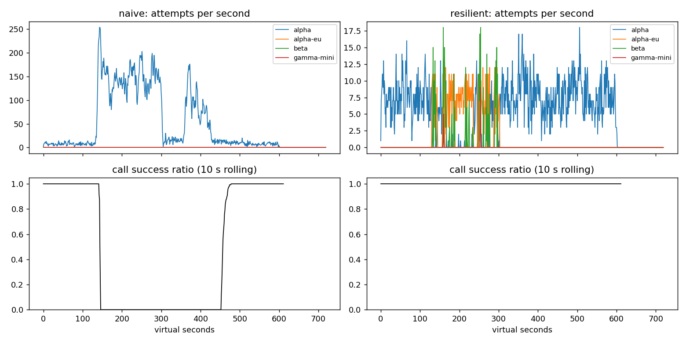

# Lab 25B — ShopAgent Game Day

**Họ tên / nhóm:** Nguyễn Minh Lương · **MSV:** 2A202602618 · **Commit:** 7b5c84a (commit mã nguồn; commit artefact ở lịch sử Git) · **Điểm tự động:** 84/88 (4 điểm SLO ẩn chưa có dữ liệu)

Số liệu dùng seed 25, cấu hình trong `configs/gameday.yaml`. Artefact gốc: `reports/gameday/`, `reports/cache/`, `reports/workflows.json`, `reports/slo.json`, `reports/experiments.json`.

## 1. Kết quả Game Day

| Băng | Client | Availability | p95 (s) | Amplification | Retry ratio | Cost/good turn | Recovery (s) | PASS |
|---|---|---:|---:|---:|---:|---:|:---:|
| G1 | naive | 0.7194 | 7.157 | 7.738 | 6.738 | 2.163 | 4 | không |
| G1 | resilient | 1.0000 | 4.776 | 1.062 | 0.002 | 2.101 | 0 | có |
| G2 | naive | 0.4560 | 15.034 | 9.904 | 8.904 | 4.627 | 155 | không |
| G2 | resilient | 1.0000 | 11.217 | 1.044 | 0.005 | 2.129 | 0 | có |
| G3 | naive | 1.0000 | 4.768 | 1.164 | 0.164 | 2.328 | 0 | không |
| G3 | resilient | 1.0000 | 4.718 | 1.065 | 0.035 | 2.146 | 0 | có |
| G4 | naive | 1.0000 | 13.764 | 1.004 | 0.004 | 2.008 | 0 | không |
| G4 | resilient | 1.0000 | 5.684 | 1.013 | 0.002 | 2.069 | 0 | có |
| G5 | naive | 0.3699 | 5.359 | 17.030 | 16.030 | 2.124 | — | không |
| G5 | resilient | 0.8179 | 5.477 | 1.003 | 0.002 | 2.504 | — | có |
| G6 | naive | 0.5170 | 4.836 | 12.344 | 11.344 | 2.009 | 0 | không |
| G6 | resilient | 1.0000 | 5.958 | 1.053 | 0.019 | 2.203 | 0 | có |

## 2. Cấu hình client và lý do

| Tham số | Giá trị | Lý do theo số liệu |
|---|---:|---|
| `attempt_timeout_s` | 8 s | G6 đạt 100% availability; đối chứng 30 s chỉ 94,88%, 122 lượt hết deadline. |
| `max_attempts_per_provider` | 2 | Chỉ một retry/tầng; G2 amplification 1,044 so với naive 9,904. |
| `min_time_left_s` | 1 s | Không tạo attempt vô ích sát deadline 30 s. |
| `backoff_base_s / cap_s` | 0,25 / 4 s | Full jitter phân tán retry; G1 không vi phạm `retry-after`. |
| `retry_budget_ratio / min_per_s / max_tokens` | 0,1 / 0,5 / 20 | G3 retry ratio 0,035; khi tắt budget và breaker G2 amplification tăng 1,378 → 1,675. |
| `quota_cooldown_s` | 300 s | G5 availability 0,8179, client error không bị retry. |
| `breaker.window_size / min_calls` | 20 / 10 | Đủ mẫu để tránh trip do một vài lỗi, phát hiện G2/G4. |
| `breaker.failure_rate_threshold` | 0,5 | G2 hồi phục 0 s thay vì 155 s. |
| `breaker.slow_call_s / slow_rate_threshold` | 5 s / 0,6 | G4 p95 5,684 s thay vì 13,764 s. |
| `breaker.open_duration_s` | 10 s | Giảm tải trong sự cố, probe để trở lại alpha; G2 primary share sau hồi phục đạt ngưỡng. |
| `breaker.half_open_max_probes / successes` | 2 / 2 | Giới hạn request thăm dò đồng thời, đóng khi có 2 kết quả tốt. |

| Lỗi | Breaker | Retry cùng deployment | Failover | Cooldown |
|---|---|---|---|---|
| 400/client | release | không | không | không |
| 429 hết quota | release | không | có | 300 s |
| 429 rate limit | release | không | có | tôn trọng `retry-after` |
| 529/503/500/timeout | ghi failure | tối đa 1 nếu budget và deadline cho phép | có | breaker mở khi đủ tỷ lệ lỗi |

## 3. Ba thí nghiệm đối chứng

1. **Retry budget.** Đặt `min_calls=10^9`, tối đa 5 attempt/deployment. Trên G2, bật budget: amplification 1,378, retry ratio 0,058, recovery 0 s, availability 99,83%; tắt budget: 1,675, 0,495, 25 s, 96,66%. Trên G3, amplification tăng 1,136 → 1,162, retry ratio 0,068 → 0,159 khi tắt. Breaker đang hoạt động bắt lỗi sớm nhưng có thể cấu hình sai hoặc chưa đủ mẫu; budget giới hạn tải retry độc lập với breaker.
2. **Timeout 30 s.** Trên G6, 8 s cho availability 100% và p95 5,958 s; 30 s cho 94,88%, 122 `deadline`, p95 nhìn có vẻ tốt hơn (5,362 s) do chỉ đo lượt thành công. G4 vẫn 100%, p95 5,684 → 5,608 s vì breaker bắt call chậm thành công; không có outage kéo dài. Timeout nên dựa vào tail latency bình thường và phần deadline cần dành cho failover, không đơn thuần bằng deadline user.
3. **Bỏ lọc tool calling.** Trên G6, ladder sai gửi 235 tool call vào `gamma-mini`, gây 235 `incompatible_model_output`, availability 90,15% thay vì 100%. Với người dùng, đó là 235 lượt mà phương án dự phòng được chọn nhưng không có khả năng hoàn tất thao tác hoàn tiền.

## 4. Workflow hoàn tiền

| Executor | Completion | Crashes | Duplicate refunds | Duplicate emails | Lost refunds | Overpaid (cents) | Wasted LLM/crash |
|---|---:|---:|---:|---:|---:|---:|---:|
| naive | 1,0 | 81 | 128 | 81 | 0 | 1.496.700 | 1,123 |
| yours | 1,0 | 66 | 0 | 0 | 0 | 0 | 0,303 |

Idempotency key ổn định ngăn payment/email lặp khi response mất hoặc worker chết, nhưng không tránh chạy lại LLM và các bước đã hoàn thành. Checkpoint sau khi thành công tránh tính toán lại nhưng riêng nó không xử lý khoảng giữa side effect và ghi checkpoint. Ghi checkpoint trước payment có thể báo hoàn thành dù tiền chưa được chuyển, tạo lost refund. WorkerCrash phải lan ra runner để khởi động worker mới.

## 5. Alerting và error budget

| Sự cố | Mong đợi | Naive | Burn-rate | Độ trễ burn-rate (phút) |
|---|---|---|---|---:|
| checkout_bug | page | page | page | 27 |
| provider_outage | page | page | page | 4 |
| deploy_blip | none | page sai | none | — |
| slow_leak | ticket | bỏ sót | ticket | 1337 |
| degraded_evening | page | page | page | 291 |
| night_spike | none | page sai | none | — |
| small_bump | none | page sai | none | — |

30 ngày có 25.901.755 request, 55.618 bad; ngân sách 129.508,8 bad, tiêu 42,95%, còn 57,05%; **không đóng băng release**. `small_bump` không page vì dù 5 phút có thể xấu, hai cửa sổ dài và ngắn phải đồng thời vượt ngưỡng; 20 phút lỗi 12% chưa đủ đốt ngân sách ở tốc độ page.

## 6. Postmortem blameless: G2, client naive

**Tóm tắt.** Alpha mất 75% GPU ở t=120–300 s. Bản v1 dùng ba tầng retry, delay cố định, không breaker và không fallback, tạo 34.475 attempt cho 3.481 call (amplification 9,904). Dù GPU phục hồi ở t=300, tải do retry và request đã bị client bỏ vẫn giữ hàng đợi nghẹt; recovery mất thêm 155 s.

**Ảnh hưởng.** 1.285/2.362 lượt thất bại, availability 45,6%, p95 của lượt thành công 15,034 s. Cửa sổ từ t=120 tới khoảng t=455 dài 335 s, trong đó có 155 s sau khi GPU hồi phục. Với giả định lưu lượng danh nghĩa 4 lượt/s cả tháng: ngân sách lỗi tháng là `4 × 86400 × 30 × 0,005 = 51.840`; riêng 1.285 lượt này tiêu 2,48% ngân sách đó.

| Khoảng t (s) | Sự kiện | Attempts alpha/s | Calls OK / done |
|---:|---|---:|---:|
| 90–119 | Trước sự cố | 7,9 | 100% (234 done) |
| 120–149 | Mất GPU ở t=120, retry bùng lên | 90,8 | 52,0% (98 done) |
| 180–209 | Hàng đợi nghẹt | 140,3 | 0% (118 done) |
| 270–299 | Trước khi provider phục hồi | 155,8 | 0% (127 done) |
| 300–329 | GPU đã phục hồi, client chưa | 23,4 | 0% (55 done) |
| 360–389 | Retry storm tiếp diễn | 113,2 | 0% (125 done) |
| 420–449 | Bắt đầu thoát vòng lặp | 21,5 | 0% (108 done) |
| 450–479 | Phục hồi sau khoảng t=455 | 11,5 | 90,1% (332 done) |
| 500–529 | Ổn định | 9,0 | 100% (273 done) |

**Trigger và nguyên nhân gốc.** Trigger là mất năng lực xử lý GPU của alpha. Nguyên nhân gốc nằm ở chính sách client: ba tầng retry nhân tối đa 36 attempt/call, delay đồng loạt, bỏ qua `retry-after`, không giới hạn retry và không chuyển deployment. 26.298 phản hồi rate limit và 28.381 vi phạm `retry-after` tiếp tục khuếch đại tải. Request server vẫn xử lý sau client timeout, nên retry mới cộng lên hàng đợi cũ; thành công ít đi làm client retry nhiều hơn. Đây là vòng tự duy trì sau khi provider đã khỏe.

**Điều giúp / làm tệ hơn.** Năng lực alpha cuối cùng hồi phục; không có breaker hay phương án dự phòng để giảm tải trong 155 s tiếp theo. Client mới đạt G2 availability 100%, amplification 1,044, recovery 0 s, nhưng p95 11,217 s vẫn là điểm cần cải thiện.

| # | Hành động | Loại | Owner | Cách kiểm chứng |
|---|---|---|---|---|
| 1 | Chỉ một tầng retry, full jitter, budget 10% | prevent | Agent platform | CI G2 amplification ≤ 1,6 và G3 retry ratio ≤ 0,10 trên nhiều seed |
| 2 | Breaker sliding window, slow call và giới hạn HALF-OPEN | mitigate | Reliability | G2 recovery ≤ 30 s, G4 p95 ≤ 10 s |
| 3 | Dashboard attempts/call, retry-after violation, queue wait, burn rate | detect | On-call/SRE | Alert trên sự cố giả lập trước khi hết ngân sách SLO; 0 false page trên blip |
| 4 | Fallback có kiểm tra tool capability và diễn tập outage | mitigate | Agent platform | G6 availability ≥ 95%, incompatible routes = 0 |

## 7. Điểm yếu còn lại

G2 đạt availability 100% nhưng p95 vẫn 11,217 s, cao hơn G1 4,776 s. Fallback liên tiếp có thể tích lũy thời gian chờ khi nhiều deployment cùng chậm. Hướng tiếp theo là đo tail latency theo deployment và phân bổ deadline cho từng rung, sau đó thử trên băng nhiều provider đồng thời suy giảm trước khi đưa vào production.

## 8. Cache

| Client | Availability | FAQ availability | Hit ratio | Stale served | Wrong | Outdated | Cost/good turn | PASS |
|---|---:|---:|---:|---:|---:|---:|---:|:---:|
| resilient, không cache | 0,8373 | 0,8424 | 0 | 0 | 0 | 0 | 1,386 | không |
| cached | 0,9124 | 0,9645 | 0,652 | 157 | 0 | 3 | 0,915 | có |

| Tham số cache | Giá trị | Cơ sở |
|---|---:|---|
| `similarity_threshold` | 0,95 | 0,80 cho 252 câu sai `other_question`; 0,95 cho 0 câu sai, hit 65,2%. |
| `ttl_s` | 60 s | 300 s cho 95 câu outdated; 60 s chỉ 3, hit cao hơn TTL 30 s (65,2% so với 59,2%). |
| `max_stale_s` | 600 s | Stale phục vụ 157 lượt; tắt stale giảm FAQ availability 96,45% → 87,33%. |
| `max_entries` | 500 | Giới hạn bộ nhớ và dùng LRU; đủ giữ tập FAQ trong băng C1. |

**Ngưỡng.** Với 0,80 / 0,95 / 0,97: hit lần lượt 66,9% / 65,2% / 58,4%; wrong 252 / 0 / 0; cost/good turn 1,003 / 0,915 / 0,962. Ở 0,80, embedding của những FAQ gần nhau nhưng khác câu hỏi bị nhập chung: `other_question=252`.

**TTL.** 30 / 60 / 300 s cho hit 59,2% / 65,2% / 73,1% và outdated 2 / 3 / 95. Webhook vô hiệu hóa nguồn đã báo ở t=150, nhưng thay đổi bảng phí ở t=480 không có webhook; TTL mới giới hạn thời gian câu trả lời cũ còn được coi là fresh.

**Stale-if-error.** Tắt stale làm FAQ availability 96,45% → 87,33%, stale served 157 → 0. Chỉ trả stale khi provider GiveUp và entry còn trong cửa sổ cho phép; webhook luôn xóa entry liên quan.

Câu hỏi cá nhân không cache dù tách user: trạng thái đơn hàng/tiền hoàn thay đổi nhanh, có nguy cơ lộ dữ liệu khi định danh hoặc quyền truy cập đổi, và câu trả lời cũ gây thiệt hại thực. Khi FAQ cache che outage khiến availability tổng vẫn xanh, on-call cần theo dõi riêng provider attempt success/error, breaker state, tỷ lệ `stale_served`, tuổi entry và availability của câu hỏi cá nhân.
